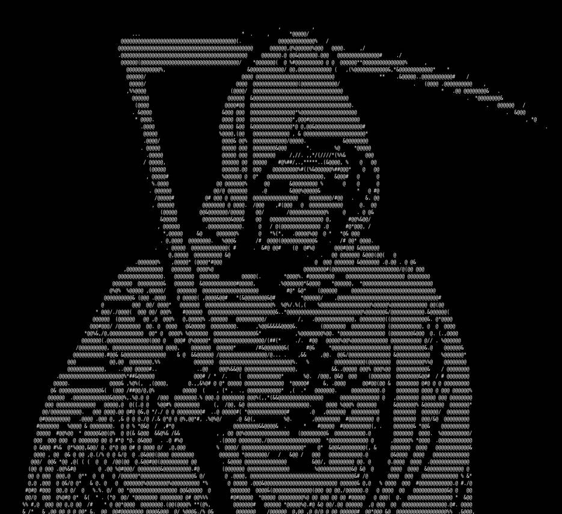

 <div style="display: flex; justify-content: space-between; align-items: center;">


--------------------------------------------------------------------------------------------------------

# "Hello World" Cybersecurity Enthusiasts

****I'm Thales Shodan, a Brazilian cybersecurity student since I was 10 years old. On this profile, I create tools to assist in pentesting for teams, from white to black hats. I work with python,c,bash script and assembly, If you want,folllow me in my channel @blackhost to be more able to new technologies. There's no place like**** ```127.0.0.1```
<div align="center">
  
 

  <br><br>

  <table>
    <tr>
      <td align="center" style="border: 2px solid #00FFFF; border-radius: 10px; padding: 10px;">
        
      </td>
    </tr>
  </table>

  <br>

  
  
  <br>
  
  <p style="color: #00FFFF; font-family: monospace; font-size: 10px; opacity: 0.6;">
    01001010 11010011 00101010 10010101 01001010 11010011 00101010 10010101<br>
    00101010 10010101 01001010 11010011 00101010 10010101 01001010 11010011<br>
    11010011 00101010 10010101 01001010 11010011 00101010 10010101 01001010
  </p>
</div>
--------------------------------------------------------------------------------------------------------------------------


````console
  ┌──(blackarch㉿Root)-[~]
  └─$ cat profile.txt 
  Name: Thales Shodan              Age: 18
  Country: Brazil                 occupation: Cybersecurity
  Goal:
    -Get  Freedom
                                                                          
  ┌──(kali㉿kali)-[~]
  └─$ cat note.txt   
  1 - Passionate about development and cybersecurity
  2 - working with terminals since I was 10
  3 - freedom is a gift
                                                                          
  ┌──(kali㉿kali)-[~]
  └─$ cat mantra.txt 
  "quod cito acquiritur cito perit ."


                                    ignotum         -

````

                 
---

###  Cybersecurity and back-end developing


[](https://skillicons.dev)


## Ferramentas de Desenvolvimento

[](https://skillicons.dev)


  <br/>
<br/>

 
****_generated with [abozanona/pacman-contribution-graph](https://abozanona.github.io/pacman-contribution-graph/)****


 

 


